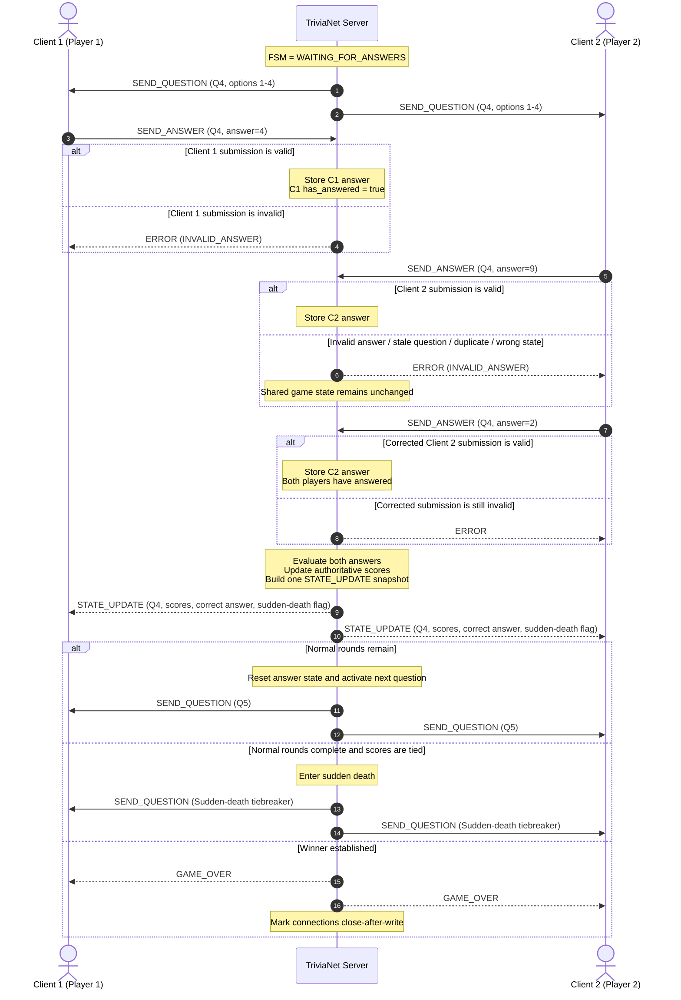

# Server Concurrency Architecture & State Synchronization Design

**System:** TriviaNet Authoritative Game Server  
**Concurrency Model:** Non-Blocking I/O Multiplexing (`selectors.DefaultSelector`)  
**Transport:** TCP with 4-byte big-endian length-prefixed UTF-8 JSON framing  
**Language/Environment:** Python 3 (`selectors`, `socket`, `struct`, `json`)

---

## 1. Concurrency Model Selection & Rationale

TriviaNet uses **non-blocking I/O multiplexing** with Python's `selectors` module. The server runs a single event loop that monitors the listening socket and all connected client sockets for readiness events.

The listening socket and every accepted client socket are placed into non-blocking mode with:

```python
sock.setblocking(False)
```

The server registers those sockets with a `selectors.DefaultSelector`. Rather than dedicating one blocking worker thread to each client, the event loop waits until one or more sockets are ready and then services the ready sockets one at a time.

Conceptually:

```text
                         +-----------------------------------+
                         |      Single-Threaded Event Loop   |
                         |    selectors.DefaultSelector      |
                         +-----------------+-----------------+
                                           |
                           waits for socket readiness
                                           |
             +-----------------------------+-----------------------------+
             |                             |                             |
             v                             v                             v
      +--------------+              +--------------+              +--------------+
      | Listen Socket|              | Client 1     |              | Client 2     |
      | EVENT_READ   |              | READ / WRITE |              | READ / WRITE |
      +--------------+              +--------------+              +--------------+
```

### 1.1 Why Selectors Fit TriviaNet

TriviaNet is a two-player lockstep trivia game. Both players receive the same question and may submit answers independently. One player may respond immediately while the other takes longer, sends an invalid message, or disconnects.

A blocking server could become stuck waiting for one client. With non-blocking sockets and a selector, the server can store the first player's answer and immediately return to the event loop to continue monitoring the second player.

This design also avoids the per-thread overhead and locking complexity of a thread-per-client model. The event loop processes one handler at a time, so game-state mutations occur sequentially within one thread.

The design therefore uses **event-loop state isolation** instead of `threading.Lock`.

### 1.2 Two-Player Capacity

One active TriviaNet match supports exactly two registered players.

- The first valid player enters the lobby and receives `LOBBY_WAIT`.
- The second valid player completes the match pair and causes `GAME_START` to be sent to both players.
- If a third client attempts to register while a match is already full, the server rejects that client at the application layer with an `ERROR` message and then closes that connection after the queued error has been transmitted.

---

## 2. Non-Blocking Socket Mechanics & Selector Event Loop

### 2.1 Readiness Events

The server uses two selector masks:

- `selectors.EVENT_READ`: the socket may have data available to read. On the listening socket, this indicates that a new TCP connection is waiting to be accepted.
- `selectors.EVENT_WRITE`: the server has queued outbound bytes and the socket may currently accept more data.

Client sockets are not permanently monitored for write events. `EVENT_WRITE` is enabled only while a client's outgoing buffer is non-empty. This prevents the selector loop from continuously waking on sockets that are almost always writable.

### 2.2 Non-Blocking Read and Write Behavior

In non-blocking mode:

- `recv()` returns available bytes immediately or raises `BlockingIOError` if no data is currently available.
- `send()` may transmit fewer bytes than requested, so the unsent portion must remain queued for a later write-ready event.

The server never assumes that a single `recv()` call equals one application message and never assumes that one `send()` call transmits an entire framed message.

### 2.3 Per-Client Session State

Each connected client has an independent session record:

```python
class ClientSession:
    def __init__(self, sock: socket.socket, addr: tuple):
        self.sock = sock
        self.addr = addr

        self.player_id: str | None = None
        self.user_alias: str | None = None
        self.is_registered: bool = False
        self.has_answered: bool = False

        self.in_buffer = bytearray()
        self.out_buffer = bytearray()
        self.expected_payload_len: int | None = None

        self.close_after_write: bool = False
```

The input and output buffers are per-client so bytes from one TCP connection can never be mixed with bytes from the other connection.

### 2.4 Core Event Loop

A simplified event loop is:

```python
def run_server_loop(
    listening_sock: socket.socket,
    selector: selectors.DefaultSelector
) -> None:
    while True:
        events = selector.select(timeout=0.1)

        for key, mask in events:
            sock = key.fileobj
            session = key.data

            if session is None:
                handle_accept(sock, selector)
                continue

            if mask & selectors.EVENT_READ:
                handle_client_read(session, selector)

            if mask & selectors.EVENT_WRITE:
                handle_client_write(session, selector)
```

Each event handler must remain short and non-blocking. Long-running blocking work would stall the entire event loop and prevent the other client from being serviced.

---

## 3. Comprehensive Connection Lifecycle

Each client connection passes through six major phases:

```text
Listening
   |
   v
TCP Accepted
   |
   v
Application Registration (CONNECT)
   |
   v
Lobby / Match Assignment
   |
   v
Active Game Servicing
   |
   v
Teardown / Socket Close
```

### 3.1 Phase 1: Server Initialization

The server:

1. Creates an IPv4 TCP socket with `socket.AF_INET` and `socket.SOCK_STREAM`.
2. Sets `SO_REUSEADDR`.
3. Binds to the configured host and port.
4. Calls `listen()`.
5. Sets the listening socket to non-blocking mode.
6. Registers the listening socket with the selector for `EVENT_READ`.

Example:

```python
listening_sock = socket.socket(socket.AF_INET, socket.SOCK_STREAM)
listening_sock.setsockopt(socket.SOL_SOCKET, socket.SO_REUSEADDR, 1)
listening_sock.bind((HOST, PORT))
listening_sock.listen(5)
listening_sock.setblocking(False)

selector.register(
    listening_sock,
    selectors.EVENT_READ,
    data=None,
)
```

A `None` selector data value identifies the socket as the master listening socket.

### 3.2 Phase 2: TCP Accept and Client Registration

When the listening socket becomes readable, the server calls `accept()`:

```python
client_sock, client_addr = listening_sock.accept()
client_sock.setblocking(False)
```

The server creates a `ClientSession` and registers the socket for `EVENT_READ`.

The TCP connection alone does not make the peer a registered TriviaNet player. The client must next send a valid `CONNECT` message containing a `user_alias`.

The server validates:

- `message_type == "CONNECT"`
- `user_alias` exists
- alias length is between 1 and 16 characters
- Player 2's alias does not duplicate Player 1's alias

If Player 1 registers successfully, the server sends:

```json
{
  "message_type": "LOBBY_WAIT"
}
```

When Player 2 registers successfully, the server assigns roles and sends a separate `GAME_START` payload to each client containing that client's opponent alias and Boolean role.

### 3.3 Phase 3: Ingress Framing and Message Assembly

TriviaNet uses a **4-byte big-endian unsigned length prefix** followed by a UTF-8 JSON payload.

Because TCP is a byte stream, a single `recv()` may contain:

- only part of the 4-byte header,
- a complete header and part of the payload,
- one complete framed message,
- or multiple framed messages.

The server therefore appends received bytes to `session.in_buffer`.

When at least four bytes are present and no payload length is currently pending, the server decodes the header:

```python
session.expected_payload_len = struct.unpack(
    "!I",
    session.in_buffer[:4],
)[0]

del session.in_buffer[:4]
```

The server then waits until the input buffer contains the full payload:

```python
if len(session.in_buffer) >= session.expected_payload_len:
    payload = session.in_buffer[:session.expected_payload_len]
    del session.in_buffer[:session.expected_payload_len]

    session.expected_payload_len = None

    message = json.loads(payload.decode("utf-8"))
    dispatch_message(session, message)
```

If the message is incomplete, the handler returns without blocking and leaves the partial bytes in the buffer for the next `EVENT_READ`.

After successfully extracting one full message, the handler should continue checking the buffer in case multiple complete framed messages arrived in the same TCP read.

### 3.4 Phase 4: Egress Framing and Partial Writes

Outgoing messages use the same framing rule:

```python
def queue_message(
    session: ClientSession,
    selector: selectors.DefaultSelector,
    message: dict
) -> None:
    payload = json.dumps(message).encode("utf-8")
    header = struct.pack("!I", len(payload))

    session.out_buffer.extend(header + payload)

    selector.modify(
        session.sock,
        selectors.EVENT_READ | selectors.EVENT_WRITE,
        data=session,
    )
```

When the selector reports `EVENT_WRITE`, the server attempts to send as many queued bytes as the socket currently accepts:

```python
def handle_client_write(
    session: ClientSession,
    selector: selectors.DefaultSelector
) -> None:
    try:
        sent = session.sock.send(session.out_buffer)
    except (BlockingIOError, InterruptedError):
        return

    del session.out_buffer[:sent]

    if not session.out_buffer:
        if session.close_after_write:
            close_client(session, selector)
        else:
            selector.modify(
                session.sock,
                selectors.EVENT_READ,
                data=session,
            )
```

This allows a slow client to drain its queued data over multiple write-ready events without blocking the other player's connection.

### 3.5 Phase 5: Active Game Servicing

Once two players are registered, the server sends `GAME_START` and begins the first round.

For each question:

1. The server queues `SEND_QUESTION` for both clients.
2. The FSM enters `WAITING_FOR_ANSWERS`.
3. Each client independently sends one `SEND_ANSWER`.
4. Each submission is validated and stored.
5. The event loop continues servicing sockets while waiting for the second answer.
6. Once both valid answers are stored, the server evaluates the round.
7. The server updates both cumulative scores.
8. The server creates one authoritative `STATE_UPDATE`.
9. Equivalent `STATE_UPDATE` data is queued for both clients before the next game-state transition begins.
10. The server either advances to another normal round, enters sudden death, or sends `GAME_OVER`.

### 3.6 Phase 6: Connection Teardown

A connection may be closed because of:

- a valid `DISCONNECT` message,
- `recv()` returning `b""`,
- `ConnectionResetError`,
- `BrokenPipeError`,
- `ConnectionAbortedError`,
- another unrecoverable socket/protocol failure,
- or normal completion after `GAME_OVER`.

The server first unregisters the socket from the selector and then closes it.

If a final message still needs to be sent, the server does **not** immediately close the socket. Instead, it queues the final `ERROR` or `GAME_OVER`, sets `close_after_write = True`, and allows normal `EVENT_WRITE` handling to drain the outgoing buffer. Only then is the socket unregistered and closed.

This preserves the non-blocking architecture while still allowing final application messages to be delivered when practical.

---

## 4. Shared State Isolation & Thread-Safety Analysis

### 4.1 Authoritative Game State

The server owns a centralized game-state structure:

```python
class GameSessionState:
    def __init__(self):
        self.player_1: ClientSession | None = None
        self.player_2: ClientSession | None = None

        self.p1_score = 0
        self.p2_score = 0

        self.active_question_number = 0
        self.active_question_data: dict | None = None

        self.p1_submitted_answer: int | None = None
        self.p2_submitted_answer: int | None = None

        self.is_sudden_death = False
        self.fsm_state = "WAITING_FOR_PLAYER_1"
```

The clients may request actions, but they do not directly mutate official scores, question progression, role assignments, or match outcomes.

### 4.2 Shared-State Risk Analysis

| Shared State | Mutating Events | Risk in a Threaded Design | Selector-Based Isolation |
|---|---|---|---|
| `p1_score`, `p2_score` | Round evaluation | Concurrent read-modify-write could produce lost updates | Score evaluation runs once, sequentially, after both answers are recorded |
| `p1_submitted_answer`, `p2_submitted_answer` | `SEND_ANSWER` | Two worker threads could evaluate partially updated answer state | One event handler records one answer completely before another handler runs |
| `active_question_number` | Question advancement | Concurrent reads/writes could accept stale or premature answers | Only the event-loop thread advances the active question |
| `fsm_state` | Registration, round transition, sudden death, teardown | Competing handlers could perform incompatible state transitions | FSM transitions execute sequentially in one thread |
| `player_1`, `player_2` | `CONNECT`, `DISCONNECT`, EOF/error cleanup | A broadcast could race with removal of a client | Registration, broadcasts, and removal are coordinated in one event loop |
| Per-client buffers | TCP reads/writes | Shared buffer access could corrupt framing | Each socket has its own buffers and only the event-loop thread accesses them |

### 4.3 Why `threading.Lock` Is Not Needed

No worker threads mutate `GameSessionState`. The selector loop invokes one event handler at a time and each handler completes its state transition before control returns to the selector loop.

Therefore, ordinary game-state operations do not require `threading.Lock`, `threading.RLock`, or semaphores.

The synchronization mechanism is **single-threaded event-loop isolation**.

This safety assumption depends on keeping all authoritative game-state mutation inside the event-loop thread. Future background worker threads would require a new synchronization design.

---

## 5. Answer Validation & Lockstep Round Enforcement

TriviaNet does not use alternating board-game turns. Instead, it uses **lockstep round semantics**: both players answer the same active question before the server evaluates the round.

A `SEND_ANSWER` request is accepted only if all required conditions are satisfied.

### 5.1 Validation Rules

The server verifies:

1. The client is a registered Player 1 or Player 2.
2. The FSM is currently `WAITING_FOR_ANSWERS`.
3. `question_number` matches `active_question_number`.
4. `answer` is an integer from 1 through 4.
5. The player has not already submitted an accepted answer for the current question.

The server uses the protocol's defined `ERROR` messages for failures:

- `OUT_OF_TURN`
- `INVALID_ANSWER`
- `DUPLICATE_ANSWER`
- `STALE_QUESTION`
- `MALFORMED_MESSAGE`
- `INVALID_MESSAGE_TYPE`

Invalid requests do not mutate the authoritative game state.

### 5.2 First Valid Answer

When the first valid `SEND_ANSWER` arrives:

1. The server stores the player's answer.
2. That player's `has_answered` flag becomes `True`.
3. The game remains in `WAITING_FOR_ANSWERS`.
4. The handler returns to the selector loop.
5. The server continues monitoring both clients.

No score is finalized until both players have submitted valid answers.

### 5.3 Second Valid Answer and Round Evaluation

When the second valid answer arrives:

1. The server stores the answer.
2. The server confirms that both players have now answered.
3. The FSM enters an evaluation/update state.
4. Each submitted answer is compared with the correct option.
5. Each correct player receives one point.
6. The server creates the authoritative `STATE_UPDATE`.
7. Equivalent update data is queued for both players.
8. Per-round answer state is reset before the next question is activated.

---

## 6. Score, State, and Match Synchronization

### 6.1 Authoritative Score Updates

The server is the sole authority for:

- cumulative Player 1 score,
- cumulative Player 2 score,
- the correct answer,
- whether sudden death is active,
- when the next question begins,
- and who wins the game.

Clients display the values sent by the server rather than calculating their own official score.

After evaluating a round, the server builds a `STATE_UPDATE` containing:

- `question_number`
- `correct_answer`
- `client_one_score`
- `client_two_score`
- `is_sudden_death`

The same completed server-state snapshot is used to construct both players' updates.

### 6.2 Broadcast Semantics

A broadcast does not mean that both TCP segments leave the machine at the exact same instant.

Instead, synchronization means:

1. The server completes one authoritative state transition.
2. It creates the update from that completed state.
3. It queues equivalent framed messages in both clients' outgoing buffers.
4. Only after both updates are queued does the server move on to the next game-state transition.

Each socket is then drained independently through normal `EVENT_WRITE` notifications.

This keeps both clients logically synchronized even if one TCP connection physically transmits a few milliseconds before the other.

### 6.3 Sudden Death

After the configured final normal round:

- If the scores are different, the higher-scoring player wins and the server sends `GAME_OVER` with `end_reason: "NORMAL"`.
- If the scores are tied, the server sets `is_sudden_death = True`, sends a `STATE_UPDATE` reflecting that state, and then broadcasts another `SEND_QUESTION`.
- Sudden-death rounds continue until exactly one player answers correctly while the other answers incorrectly.
- The winner is then announced with `GAME_OVER` and `end_reason: "SUDDEN_DEATH"`.

---

## 7. Mermaid Sequence Diagram

The following sequence diagram models one active trivia round, including valid and invalid answer branches, synchronized state updates, and match progression.



The diagram uses the actual TriviaNet message names defined by the wire protocol: `SEND_QUESTION`, `SEND_ANSWER`, `STATE_UPDATE`, `ERROR`, and `GAME_OVER`.

---

## 8. Error Handling & Capacity Planning

### 8.1 Protocol Errors

The server responds with an `ERROR` message when appropriate rather than allowing invalid input to mutate shared state.

Examples include:

- malformed JSON or missing fields,
- unknown `message_type`,
- answer outside the range 1-4,
- answer sent in an incompatible FSM state,
- duplicate answer,
- stale `question_number`,
- duplicate player alias.

Where safe, the connection remains open after the error because the protocol defines `ERROR` as a non-terminal response.

### 8.2 Full Lobby / Active Match

The wire protocol's standardized error-code table does not define a dedicated `GAME_FULL` or `GAME_IN_PROGRESS` error code. Therefore, this architecture should not invent one without first updating the protocol blueprint.

For implementation, one of the following must be chosen and documented consistently:

- extend the protocol blueprint with a new standardized error code for a full match, or
- reject extra clients using an existing protocol-compliant policy defined by the project.

Until the wire protocol is amended, the server architecture treats third-client handling as a capacity-policy decision that must remain consistent with the protocol specification.

### 8.3 Invalid Framing

If a decoded frame length is unreasonable or the payload cannot be decoded as valid UTF-8 JSON, the server treats the input as malformed.

If framing cannot be safely resynchronized, the server may close that client connection after any protocol-compliant error response that can still be delivered safely.

---

## 9. Disconnect, EOF, and Exception Recovery

### 9.1 Graceful `DISCONNECT`

When a client sends the protocol-defined `DISCONNECT` message:

- If the client is Player 1 waiting in the lobby, the server removes that client and returns the FSM to `WAITING_FOR_PLAYER_1`.
- If the disconnect occurs during an active match, the remaining player wins by forfeit.
- The server sends the remaining player `GAME_OVER` with `end_reason: "FORFEIT"`.

The surviving client's `GAME_OVER` is queued through the normal non-blocking output path before the connection is closed or the session is reset.

### 9.2 TCP EOF

If `recv()` returns `b""`, the peer has closed its side of the TCP connection.

The server:

1. stops reading from that socket,
2. unregisters it from the selector,
3. closes the socket,
4. removes the client from game/session state,
5. performs the same lobby reset or forfeit logic required by the current FSM state.

EOF is distinct from `BlockingIOError`; an empty byte string means the TCP peer has closed the stream.

### 9.3 Abrupt Failure

The server catches connection-level exceptions such as:

- `ConnectionResetError`
- `BrokenPipeError`
- `ConnectionAbortedError`

When these occur, the connection is treated as lost and normal cleanup/forfeit logic is applied.

### 9.4 Partial Framing During Disconnect

If a peer disconnects while only part of a 4-byte header or JSON payload has been received, the incomplete frame is discarded as part of connection cleanup.

The partial data is never dispatched to the application state machine.

### 9.5 Slow Client / Outbound Buffer Saturation

If `send()` transmits only part of `session.out_buffer`, the server removes only the transmitted bytes.

The remaining bytes stay queued and `EVENT_WRITE` remains enabled.

This prevents a slow receiver from blocking the event loop or causing bytes to be silently dropped.

---

## 10. Implementation Invariants

The implementation should maintain the following invariants:

1. Only the event-loop thread mutates authoritative game state.
2. Each client owns a separate input and output byte buffer.
3. No application message is dispatched until the full 4-byte header and complete declared payload are available.
4. `SEND_ANSWER` cannot modify state unless it passes all validation rules.
5. A player can have at most one accepted answer per active question.
6. Scores are updated only after both valid answers have been recorded.
7. `STATE_UPDATE` is built from one completed authoritative state snapshot and queued for both players before the next question begins.
8. Final `ERROR` or `GAME_OVER` messages that must be delivered before closure use the normal non-blocking output buffer and close-after-write behavior.
9. Every closed socket is unregistered from the selector before its descriptor is discarded.
10. No new application-level message type or error code is used unless it exists in the protocol blueprint or the blueprint is updated first.
