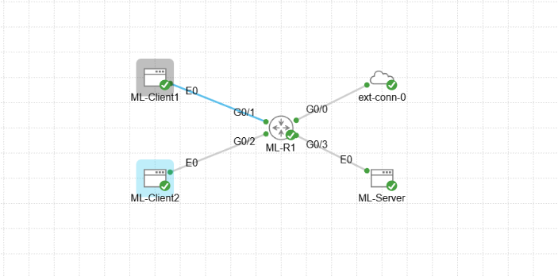
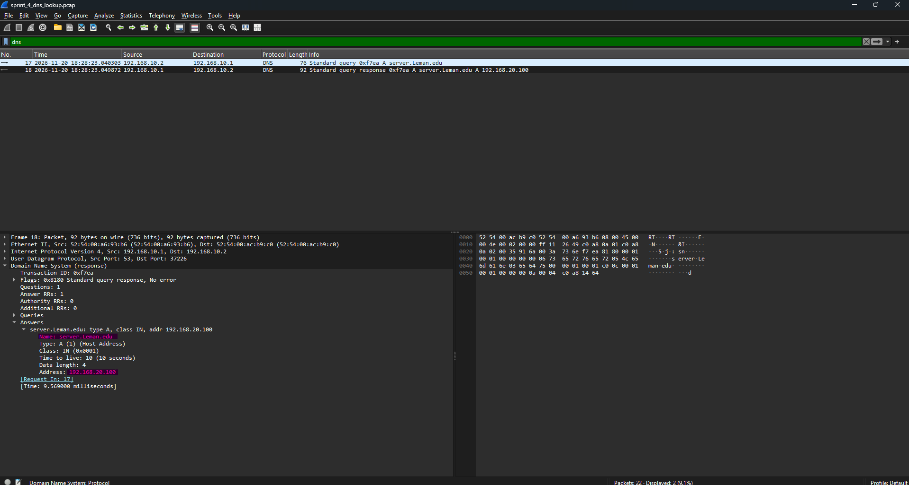

# Sprint 4 Network Verification Report

**Course:** CS 457 - Computer Networks  
**Project:** TriviaNet  
**Date:** November 20, 2026  
**DNS Hostname:** `server.Leman.edu`

---

## 1. CML Topology

The Sprint 4 topology uses one Cisco IOS router, `ML-R1`, to connect three separate IPv4 subnets.

- **Client 1 Subnet:** `192.168.10.0/24`
- **Client 2 Subnet:** `192.168.11.0/24`
- **Game Server Subnet:** `192.168.20.0/24`

Router R1 serves as the default gateway between all three networks. It also provides DHCP service for both client networks and DNS resolution for the game server.

The Game Server uses the static IPv4 address:

`192.168.20.100/24`

with default gateway:

`192.168.20.1`

### Topology Screenshot



---

## 2. Router Interface Verification

The router was configured with the following internal routed interfaces:

- `GigabitEthernet0/1` — `192.168.10.1/24`
- `GigabitEthernet0/2` — `192.168.11.1/24`
- `GigabitEthernet0/3` — `192.168.20.1/24`

The external connector is attached to `GigabitEthernet0/0` and received `192.168.255.147` through DHCP.

```text
ML-R1#show ip interface brief
Interface                  IP-Address      OK? Method Status                Protocol
GigabitEthernet0/0         192.168.255.147 YES DHCP   up                    up
GigabitEthernet0/1         192.168.10.1    YES manual up                    up
GigabitEthernet0/2         192.168.11.1    YES manual up                    up
GigabitEthernet0/3         192.168.20.1    YES manual up                    up
NVI0                       unassigned      YES unset  up                    up
```

All four router interfaces are operational with a status and protocol state of `up/up`.

---

## 3. Routing Verification

The routing table confirms that all three internal subnets are directly connected to R1.

```text
ML-R1#show ip route

Gateway of last resort is 192.168.255.1 to network 0.0.0.0

S*    0.0.0.0/0 [254/0] via 192.168.255.1

C        192.168.10.0/24 is directly connected, GigabitEthernet0/1
L        192.168.10.1/32 is directly connected, GigabitEthernet0/1

C        192.168.11.0/24 is directly connected, GigabitEthernet0/2
L        192.168.11.1/32 is directly connected, GigabitEthernet0/2

C        192.168.20.0/24 is directly connected, GigabitEthernet0/3
L        192.168.20.1/32 is directly connected, GigabitEthernet0/3

C        192.168.255.0/24 is directly connected, GigabitEthernet0/0
L        192.168.255.147/32 is directly connected, GigabitEthernet0/0
```

Because the three internal networks are directly connected to R1, no static routes are required between them. R1 can route traffic directly between the two clients and the Game Server.

The router also has a default route through `192.168.255.1`, which provides access to the CML External Connector.

---

## 4. DHCP Verification

R1 provides DHCP service to Client 1 and Client 2 using two separate DHCP pools.

Client 1 successfully received the address `192.168.10.2` from the DHCP server at `192.168.10.1`.

```text
ML-Client1:~# sudo udhcpc -i eth0
udhcpc: started, v1.37.0
udhcpc: broadcasting discover
udhcpc: broadcasting select for 192.168.10.2, server 192.168.10.1
udhcpc: lease of 192.168.10.2 obtained from 192.168.10.1, lease time 86400
```

The assigned interface configuration was:

```text
inet 192.168.10.2/24 scope global eth0
```

The DHCP configuration also installed the correct default gateway:

```text
default via 192.168.10.1 dev eth0 metric 202
192.168.10.0/24 dev eth0 scope link src 192.168.10.2
```

and the correct DNS server:

```text
nameserver 192.168.10.1
```

R1's DHCP binding table confirms active leases for both client nodes:

```text
ML-R1#show ip dhcp binding
Bindings from all pools not associated with VRF:
IP address          Client-ID/              Lease expiration        Type
                    Hardware address/
                    User name
192.168.10.2        0152.5400.acb9.c0       Nov 21 2026 10:32 PM    Automatic
192.168.11.2        0152.5400.d1bf.cf       Nov 21 2026 10:33 PM    Automatic
```

This confirms that Client 1 received an address from `192.168.10.0/24` and Client 2 received an address from `192.168.11.0/24`.

---

## 5. Game Server Configuration

The Game Server was configured with the required static IPv4 address `192.168.20.100/24`.

```text
$ ip addr show eth0
2: eth0: <BROADCAST,MULTICAST,UP,LOWER_UP> mtu 1500 qdisc pfifo_fast state UP qlen 1000
    link/ether 52:54:00:c8:98:df brd ff:ff:ff:ff:ff:ff
    inet 192.168.20.100/24 scope global eth0
       valid_lft forever preferred_lft forever
    inet6 fe80::5054:ff:fec8:98df/64 scope link
       valid_lft forever preferred_lft forever
```

The server also has the required default route through R1:

```text
$ ip route
default via 192.168.20.1 dev eth0
192.168.20.0/24 dev eth0 scope link src 192.168.20.100
```

The default route allows the server to send replies to Client 1 and Client 2, which are located on different IPv4 subnets.

---

## 6. Cross-Subnet Connectivity Verification

### Client 1 to Game Server

Client 1 successfully reached the Game Server across R1:

```text
ML-Client1:~# ping -c 4 192.168.20.100
PING 192.168.20.100 (192.168.20.100): 56 data bytes
64 bytes from 192.168.20.100: seq=0 ttl=63 time=1.882 ms
64 bytes from 192.168.20.100: seq=1 ttl=63 time=3.044 ms
64 bytes from 192.168.20.100: seq=2 ttl=63 time=2.558 ms
64 bytes from 192.168.20.100: seq=3 ttl=63 time=1.511 ms

--- 192.168.20.100 ping statistics ---
4 packets transmitted, 4 packets received, 0% packet loss
round-trip min/avg/max = 1.511/2.248/3.044 ms
```

### Client 2 to Game Server

Client 2 also successfully reached the Game Server:

```text
ML-Client2:~# ping -c 4 192.168.20.100
PING 192.168.20.100 (192.168.20.100): 56 data bytes
64 bytes from 192.168.20.100: seq=0 ttl=63 time=2.727 ms
64 bytes from 192.168.20.100: seq=1 ttl=63 time=2.635 ms
64 bytes from 192.168.20.100: seq=2 ttl=63 time=2.718 ms
64 bytes from 192.168.20.100: seq=3 ttl=63 time=2.587 ms

--- 192.168.20.100 ping statistics ---
4 packets transmitted, 4 packets received, 0% packet loss
round-trip min/avg/max = 2.587/2.666/2.727 ms
```

Both tests completed with **0% packet loss**, confirming successful routing between both client networks and the Game Server subnet.

The TTL value of `63` also shows that the packets crossed one router hop between the clients and the server.

---

## 7. DNS Configuration and Verification

R1 was configured as the DNS server for the client networks.

The router contains the following permanent hostname mapping:

```text
ML-R1#show hosts
Default domain is not set
Name/address lookup uses domain service
Name servers are 192.168.255.1

Host                      Port  Flags      Age Type   Address(es)
server.Leman.edu          None  (perm, OK)  0   IP    192.168.20.100
```

This maps:

`server.Leman.edu` → `192.168.20.100`

### Client 1 DNS Test

```text
ML-Client1:~# nslookup -type=A server.Leman.edu
Server:         192.168.10.1
Address:        192.168.10.1:53

Non-authoritative answer:
Name:   server.Leman.edu
Address: 192.168.20.100
```

Client 1 successfully queried R1 at `192.168.10.1` and received the correct IPv4 address.

### Client 2 DNS Test

```text
ML-Client2:~# nslookup -type=A server.Leman.edu
Server:         192.168.11.1
Address:        192.168.11.1:53

Non-authoritative answer:
Name:   server.Leman.edu
Address: 192.168.20.100
```

Client 2 successfully queried R1 at `192.168.11.1` and also received the correct IPv4 address.

These results confirm that DNS resolution works from both client subnets.

---

## 8. Wireshark DNS Packet Analysis

A Wireshark packet capture was taken while a client executed:

```bash
nslookup -type=A server.Leman.edu
```

The capture contains a DNS Standard Query from the client to R1 using UDP port 53.

R1 responds with a DNS Standard Response containing an IPv4 A record mapping:

`server.Leman.edu` → `192.168.20.100`

### Annotated Wireshark DNS Screenshot



The screenshot should identify:

1. The DNS Standard Query for `server.Leman.edu`.
2. The DNS Standard Response from R1.
3. The returned A record containing `192.168.20.100`.


---

## 9. Conclusion

The Sprint 4 CML network successfully connects two dynamically addressed client networks and one statically addressed Game Server network through a single Cisco IOS router.

R1 successfully provides:

- Inter-subnet IPv4 routing
- DHCP service for both client networks
- DNS resolution for the Game Server
- Connectivity to the external CML network

Client 1 received `192.168.10.2`, while Client 2 received `192.168.11.2`. The Game Server uses the static address `192.168.20.100`.

Both clients successfully reached the Game Server with 0% packet loss and successfully resolved `server.Leman.edu` to `192.168.20.100`.

The Wireshark DNS capture provides packet-level verification of the DNS query and response.